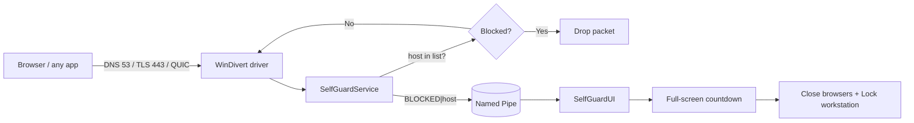

<div align="center">

# 🛡️ SelfGuard
<div align="center" dir="rtl">

> **قُل لِّلۡمُؤۡمِنِينَ يَغُضُّواْ مِنۡ أَبۡصَٰرِهِمۡ وَيَحۡفَظُواْ فُرُوجَهُمۡۚ ذَٰلِكَ أَزۡكَىٰ لَهُمۡۚ إِنَّ ٱللَّهَ خَبِيرُۢ بِمَا يَصۡنَعُونَ** ﴿٣٠﴾
>
> — سورة النور

</div>
**A self-discipline & content-blocking tool for Windows (C# / .NET 8)**


</div>

---

## Table of Contents

- [Overview](#overview)
- [Features](#features)
- [How It Works](#how-it-works)
- [Architecture](#architecture)
- [Installation](#installation)
- [Verifying the Installation](#verifying-the-installation)
- [Recommended Browser Settings](#recommended-browser-settings)
- [Uninstallation](#uninstallation)
- [Building from Source](#building-from-source)
- [Known Limitations](#known-limitations)
- [Security Notes](#security-notes)
- [Credits](#credits)
- [License](#license)

---

## Overview

**SelfGuard** is a Windows tool that helps you stay committed to your own decision to avoid adult content. It blocks domains from an encrypted list **at the network level for the whole machine**. This means it works in every browser, including private/incognito windows.

When a blocked site is requested, the connection is dropped. A full-screen reminder then appears with a 10-second countdown, the browsers are closed, and the workstation is locked.

> [!IMPORTANT]
> SelfGuard is built for **voluntary self-discipline**, not for secret monitoring. It runs as a clearly named service (`SelfGuard Content Blocker`) and appears in *Installed Apps*.

> [!WARNING]
> The project is experimental and has had limited testing. Try it in a virtual machine first, or create a System Restore point before installing.

---

## Features

- 🌐 **Network-level blocking** using [WinDivert](https://reqrypt.org/windivert.html):
  - Inspects **DNS** queries (UDP/TCP port 53).
  - Inspects **TLS SNI** in the ClientHello (TCP port 443) and drops blocked connections.
  - Blocks **QUIC** (UDP 443) so browsers fall back to TCP/TLS, where the SNI is visible.
- 🔒 **Encrypted domain list**: about 593 unique domains stored with AES-256-CBC (PBKDF2-SHA256) and embedded in the service.
- 🌳 **Subdomain matching**: blocking `example.com` also blocks `*.example.com`.
- 🖥️ **Full-screen reminder** on every monitor, with a 10 → 0 countdown, then browsers are closed and the session is locked.
- ⚙️ **Windows Service** running as `LocalSystem`, set to auto-start, with automatic restart on failure.
- ⏳ **24-hour cooling-off period** before uninstalling. You can cancel it at any time. Its state is encrypted with DPAPI.
- 📦 Appears in **Settings → Apps → Installed apps** for a standard uninstall flow.

---

## How It Works



1. The service captures outbound packets with WinDivert.
2. It extracts the hostname from DNS queries or from the TLS SNI field.
3. If the host matches the blocked list, the packet is dropped and never re-injected.
4. The service sends `BLOCKED|<host>` through a named pipe (debounced to once every 3 seconds).
5. `SelfGuardUI` shows the reminder, closes the browsers, and locks the workstation.

---

## Architecture

| Project | Type | Role |
|---|---|---|
| `DomainListBuilder` | Console | Reads `sites.json`, normalizes it, removes whitelisted entries, and encrypts the result into `blocked_domains.enc` |
| `SelfGuardService` | Windows Service (LocalSystem) | WinDivert packet inspection, blocking, QUIC drop, pipe server, and cooling-off state |
| `SelfGuardUI` | WPF | Listens for events, shows the full-screen countdown, closes browsers, and locks the PC |
| `SelfGuardInstaller` | WinForms (requires admin) | Copies files, registers and starts the service, adds the autostart key and the *Installed Apps* entry |
| `SelfGuardUninstaller` | WinForms (requires admin) | Talks to the service to start, cancel, or complete the 24-hour uninstall flow |
| `Shared` | Shared files | `ServiceApi.cs` (Service Control Manager P/Invoke) and `admin.app.manifest` |

### Named Pipes

| Pipe | Direction | Messages |
|---|---|---|
| `\\.\pipe\SelfGuard.Events` | Service → UI | <code>BLOCKED|host</code> |
| `\\.\pipe\SelfGuard.Control` | Uninstaller → Service | `UNLOCK_STATUS`, `CANCEL_UNLOCK` |

### Files and Locations

| Item | Path / Name |
|---|---|
| Install directory | `C:\Program Files\SelfGuard` |
| Data directory | `C:\ProgramData\SelfGuard` (`state.dat`) |
| Service name | `SelfGuardBlockerService` |
| Service display name | `SelfGuard Content Blocker` |
| UI autostart | `HKLM\SOFTWARE\Microsoft\Windows\CurrentVersion\Run` → `SelfGuardUI` |

---

## Installation

### Requirements

- Windows 10 / 11 (x64)
- Administrator rights
- No need to install .NET, because the release is self-contained.

### Steps

1. Go to the [**Releases**](../../releases) page and download the latest release.
2. Extract the archive, then confirm that **`SelfGuardInstaller.exe` sits next to the `payload` folder**.

   ```text
   SelfGuard/
   ├── SelfGuardInstaller.exe
   └── payload/
       ├── SelfGuardService.exe
       ├── SelfGuardUI.exe
       ├── SelfGuardUninstaller.exe
       ├── WinDivert.dll
       ├── WinDivert64.sys
       └── ... (runtime files)
   ```

   > [!CAUTION]
   > The installer copies everything from the `payload` folder. If the folder is missing or incomplete, the installation fails.

3. **Add the folder to your antivirus exclusions.** `WinDivert64.sys` is a network driver, and some security products flag it.
4. Double-click `SelfGuardInstaller.exe` and accept the **UAC** prompt.
   - If **SmartScreen** appears, click **More info → Run anyway**. The executable is not code-signed.
5. Confirm the installation dialog.
6. The installer will:
   - [x] Stop any previous version
   - [x] Copy files to `C:\Program Files\SelfGuard`
   - [x] Register, configure, and start the Windows service
   - [x] Add the UI to startup for all users and launch it
   - [x] Add the entry to *Installed Apps*

### Verifying the Installation

```powershell
Get-Service SelfGuardBlockerService
```

The status should be `Running`. Then visit a domain from the blocked list. The reminder screen should appear.

If something fails, check the Windows Event Log:

```powershell
Get-WinEvent -FilterHashtable @{LogName='Application'; ProviderName='SelfGuard'} -MaxEvents 10 | Format-List TimeCreated, Message
```

---

## Recommended Browser Settings

To close the known gaps, apply the following settings.

<details>
<summary><b>Chrome / Edge</b></summary>

- Disable **Use secure DNS**.
- Disable Encrypted Client Hello with the policy `EncryptedClientHelloEnabled = 0`.

</details>

<details>
<summary><b>Firefox</b> (via <code>about:config</code>)</summary>

| Preference | Value |
|---|---|
| `network.trr.mode` | `5` |
| `network.dns.echconfig.enabled` | `false` |

</details>

---

## Uninstallation

Uninstalling is deliberately slowed down with a **24-hour cooling-off period**.

1. Open **Settings → Apps → Installed apps → SelfGuard Content Blocker → Uninstall**.
2. **First run:** the service records your request and the 24-hour period starts. Nothing is removed yet.
3. **During the period:** running the uninstaller again shows the remaining time. You can **cancel** the request and keep the protection.
4. **After 24 hours:** run the uninstaller again and confirm. It will:
   - Stop and delete the service
   - Close the UI processes
   - Remove the startup and *Installed Apps* registry entries
   - Delete `C:\Program Files\SelfGuard` and `C:\ProgramData\SelfGuard`

> [!NOTE]
> If the service is not running, the uninstaller refuses to proceed and asks you to start it first. This is intentional (fail-closed).

---

## Building from Source

> Not required if you use the release.

**Prerequisites:** .NET 8 SDK, and `WinDivert.dll` + `WinDivert64.sys` (WinDivert 2.2.x, x64) placed in `third_party\WinDivert\`.

```powershell
New-Item -ItemType Directory -Force dist\payload | Out-Null

dotnet publish SelfGuardService     -c Release -r win-x64 --self-contained true -o dist\payload
dotnet publish SelfGuardUI          -c Release -r win-x64 --self-contained true -o dist\payload
dotnet publish SelfGuardUninstaller -c Release -r win-x64 --self-contained true -p:PublishSingleFile=true -o dist\payload
dotnet publish SelfGuardInstaller   -c Release -r win-x64 --self-contained true -p:PublishSingleFile=true -o dist

Copy-Item third_party\WinDivert\WinDivert.dll   dist\payload\
Copy-Item third_party\WinDivert\WinDivert64.sys dist\payload\
```

To regenerate the encrypted domain list from a modified `sites.json`:

```powershell
dotnet run --project DomainListBuilder -c Release -- path\to\sites.json SelfGuardService\Resources\blocked_domains.enc
```

---

## Known Limitations

| Limitation | Details |
|---|---|
| **DNS-over-HTTPS** | Not visible on port 53, but SNI filtering on port 443 still catches it. |
| **Encrypted Client Hello (ECH)** | Hides the SNI. Disable it in the browser or via policy. |
| **VPN / proxy** | Traffic tunneled through them bypasses inspection. |
| **Administrators** | An admin can always stop a service. This is by design. |
| **Domain-based only** | Only domains in the list are blocked. |
| **Experimental** | Limited testing; expect rough edges. |

---

## Security Notes

- The domain list is **obfuscated, not secret**: the AES key material is embedded in the binaries. Encryption here only prevents casual reading.
- The tool does not log or transmit browsing data off the machine. Only blocked hostnames are written to the Windows Event Log.
- The UI is not a trap: `Ctrl+Alt+Del` still works.

---

## Credits

- [WinDivert](https://reqrypt.org/windivert.html) — packet interception library. Please review its license before redistributing.


